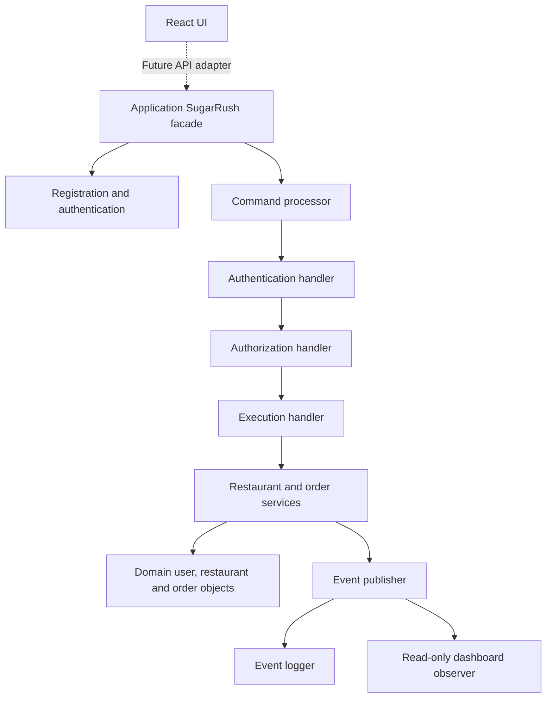

# System architecture implementation

The backend uses Java; the existing UI uses React. The application and domain
folders are Java packages inside the backend source tree. The UI lives in
`ui/` at repository root. This keeps the document's layer names while respecting
the two language toolchains.

## Document-to-code mapping

| Document component | Package or class |
| --- | --- |
| REG accounts and exactly one role | domain.user.User / Role; application.auth.RegistrationService |
| REG sessions | domain.user.Session; application.auth.AuthenticationService |
| Seed loader | application.seed.SeedLoader; backend/config/demo.properties |
| Chain of Responsibility | application.commands.*Handler / CommandProcessor |
| Restaurant service | application.restaurant.RestaurantService |
| Order service | application.order.OrderService |
| State pattern | domain.order.OrderState and seven concrete states |
| Observer pattern | application.events.OrderEventPublisher / OrderObserver |
| Transaction records | domain.order.OrderEvent; application.events.EventLogger |
| Dashboard projection | application.events.DashboardObserver |
| Per-role command menu | application.commands.Action.menu; ROLE_MENU command |

The domain has no imports from application or UI. Order lines reference immutable
menu-item snapshots, preserving prices if a restaurant edits its menu later.
Restaurants enforce open status and menu membership when an order is created.
Orders enforce nonempty lines, quantities and legal state transitions.

Accepted orders enter their restaurant's FIFO preparation queue. An order can
start preparing only at the head; it stays there until ready, then leaves the
queue. A cancelled order leaves the queue without reordering the others.
This implementation follows the document's arrival-order requirement
using acceptance/enqueue order. If the intended rule is original placement order
even when staff accept out of order, that should be clarified in the SA.

An order is created in Placed and emits a creation event with null previous state.
Every successful subsequent transition generates another unique UUID event.
Invalid operations emit no order event. Command logs record successes and errors
without storing credentials or session tokens. Dashboard and event/command log
access is restricted to operators; customers and staff get filtered order views.

## Application access

The facade exposes registration, login and authenticated command execution.
Role menus and permission checks share the same action catalog. A command never
accepts a trusted customer ID or role from the caller: these come from the session.
Restaurant commands additionally check the authenticated user's ownership,
except that operators may pause or reopen any restaurant. Browsing returns only
the staff member's own restaurants; customers and operators see all of them.
Operator registration is reserved for trusted bootstrap.

The local account service stores salted PBKDF2 password hashes, not plaintext
passwords; plaintext seed credentials exist only in the demo configuration.
Facade calls serialize access to the volatile stores. A new application instance
reloads the fixture into fresh state; persisted identifiers are not promised.
Seed loading fails before returning the app if a role or field is missing.

## Current phase and integration

Placed -> Accepted -> Preparing -> Ready and Placed -> Rejected are exposed as
commands. Customers cancel their own Placed orders; operators cancel Accepted or
Preparing orders. PickedUp and Delivered are implemented as domain states for the full
lifecycle, but courier commands and delivery assignment are deferred as the
document's phase description requires. Courier accounts still have their own
role menu and authenticated shared commands.

No map, new React screens, wallet, favorites, promotions, payments or email
verification are implemented. Those use cases are unfinished in the supplied
document and fall outside its REG/ORD architecture for this phase.

The React app still uses Firebase authentication and profiles. The Java facade
currently uses local demo accounts and sessions and has no HTTP transport.
Connecting them requires a trusted Firebase Admin adapter that verifies ID
tokens and loads server-approved roles and ownership; client-created Firebase
profile roles must not become backend authority. Durable repositories are also
a future integration task. Event logs and dashboard projections currently live
in memory; observer failures are isolated and reported, without durable retries.

Services and handlers are application internals. A future HTTP adapter should
expose only the facade and immutable results. Domain mutations return events;
the order service owns publication, keeping domain objects independent of
session management, logging and dashboard subscribers.
