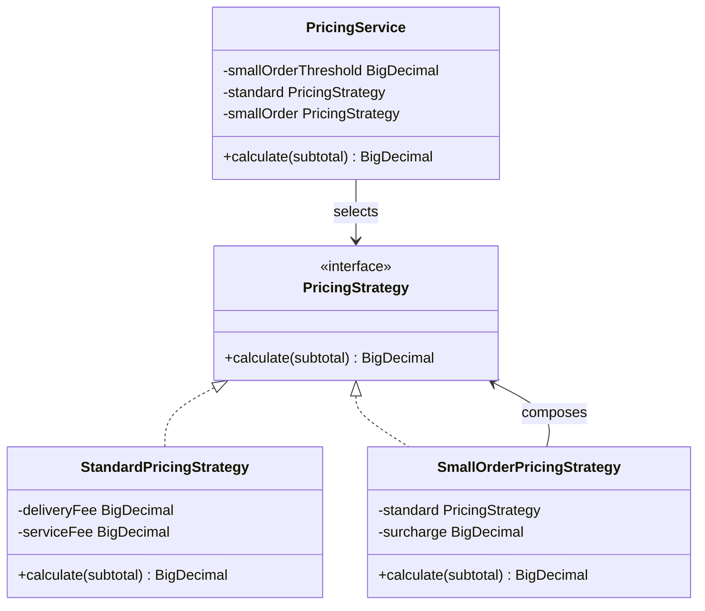

# Phase III pricing section for the team report

## R-PRC-01 pricing rules

The order subtotal is the sum of each menu item's price at placement multiplied by its quantity. The fare adds a delivery fee and a service fee. When the subtotal is strictly below the small-order threshold, it also adds a small-order surcharge. The threshold comparison uses the item subtotal before fees. The configured values are in `backend/config/app.properties`:

| Configuration property | Value (CAD) |
| --- | ---: |
| `pricing.deliveryFee` | $3.00 |
| `pricing.serviceFee` | $1.00 |
| `pricing.smallOrderThreshold` | $15.00 |
| `pricing.smallOrderSurcharge` | $2.00 |

For a hand calculation, one Chocolate Cake costs $8.50. Its subtotal is $8.50, which is below $15.00, so its fare is $8.50 + $3.00 + $1.00 + $2.00 = **$14.50**. Two Chocolate Cakes cost $17.00; their fare is $17.00 + $3.00 + $1.00 = **$21.00**. At exactly $15.00, the surcharge does not apply. The implementation uses `BigDecimal` arithmetic and requires two-decimal money values, avoiding floating-point variation.

## Strategy pattern justification

`PricingService` selects a `PricingStrategy` from the immutable order-line subtotal. `StandardPricingStrategy` adds the delivery and service fees. `SmallOrderPricingStrategy` composes the standard strategy and adds the surcharge. This separates the variable pricing rule from order lifecycle handling, while both branches use the same configured fees. The four settings are loaded once when the application starts, and the order lines retain their menu price snapshots, so repeated calculations of the same order produce the same fare. We considered one conditional formula inside `OrderService`, but separate strategies make the rule selection explicit and keep the fee calculation in one place.

The class diagram should be rendered with a diagram tool before inclusion in the submitted PDF. AI assistance disclosure for this contribution: Codex helped draft the pricing classes, integration checks, and this report section; the team should review the implementation and name the tool in its final report disclosure.
